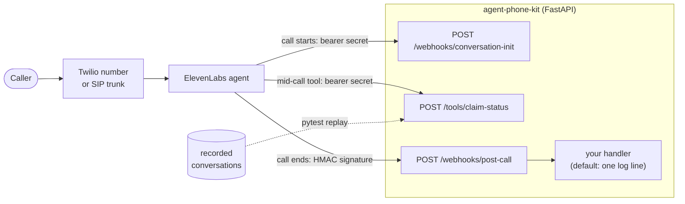

# agent-phone-kit

[](https://github.com/woodbeary/agent-phone-kit/actions/workflows/ci.yml)

A small Python kit for the server side of an ElevenLabs phone agent:

- **A server tool.** A FastAPI endpoint the agent calls mid-call (here, an insurance
  claim-status lookup), protected by a bearer secret.
- **A post-call webhook receiver.** It checks the `ElevenLabs-Signature` HMAC on the
  raw body, rejects stale timestamps, drops repeat deliveries and hands each event
  to your handler.
- **Replay tests.** A pytest plugin that takes recorded conversations, re-sends
  every tool request the agent made, and fails with a field-by-field diff when your
  tools now answer differently.
- **Telephony docs.** How to attach the agent to a [Twilio number](docs/twilio.md)
  or a [SIP trunk](docs/sip-trunking.md), with request bodies for ElevenLabs'
  phone-number API.

All data in the repo is synthetic. Phone numbers in tests use the 555-01XX range
reserved for fiction.



## Quick start

Python 3.11 or newer.

```bash
git clone https://github.com/woodbeary/agent-phone-kit && cd agent-phone-kit
python -m venv .venv && . .venv/bin/activate
pip install -e ".[dev]"
pytest

export TOOL_BEARER_SECRET="$(python -c 'import secrets; print(secrets.token_urlsafe(32))')"
export ELEVENLABS_WEBHOOK_SECRET="the secret ElevenLabs shows for your webhook"
uvicorn agent_phone_kit.app:create_app --factory --port 8000
```

```bash
curl -s localhost:8000/tools/claim-status \
  -H "Authorization: Bearer $TOOL_BEARER_SECRET" \
  -H "Content-Type: application/json" \
  -d '{"claim_number": "clm 1002"}'
# {"found":true,"claim_number":"CLM-1002","status":"in review",...}
```

To use it from another project: `pip install git+https://github.com/woodbeary/agent-phone-kit@v0.1.0`.

## The server tool

`POST /tools/claim-status` takes `{"claim_number": ..., "conversation_id": ...}`
and answers with a `message` the agent can read out. "Not found" and "that isn't a
claim number" are ordinary 200 answers so the agent can carry on the call; only
a backend failure is an error (503). Claim numbers are normalized, so `clm 1001`,
`CLM_1001` and `1001` all find `CLM-1001`.

The tool config to paste into ElevenLabs is
[`examples/elevenlabs/claim_status_tool.json`](examples/elevenlabs/claim_status_tool.json).
It fills `conversation_id` from the `system__conversation_id` dynamic variable and
sends the `Authorization` header from a workspace secret. Store the secret's value
as `Bearer <TOOL_BEARER_SECRET>`; if your first call gets a 401, check that prefix.

To use your own claims system, implement `ClaimStore.get()` and pass it in:
`create_app(claims=MyStore())`.

## The post-call webhook

ElevenLabs signs each delivery. Per its
[post-call webhook docs](https://elevenlabs.io/docs/eleven-agents/workflows/post-call-webhooks),
you verify the `ElevenLabs-Signature` header with the SDK's `construct_event`.
That function ([source](https://github.com/elevenlabs/elevenlabs-python/blob/main/src/elevenlabs/webhooks_custom.py))
defines the scheme this kit implements:

| | |
| --- | --- |
| Header | `ElevenLabs-Signature: t=<unix seconds>,v0=<hex digest>` |
| Digest | HMAC-SHA256 over `"<t>.<raw request body>"`, keyed with the webhook secret |
| Stale | rejected when `t` is more than 30 minutes old |

`agent_phone_kit.signature.verify_signature` follows that, and also compares
digests in constant time, rejects timestamps more than 5 minutes in the future,
and lets you change the 30-minute window (`WEBHOOK_TOLERANCE_SECONDS`).

The receiver at `POST /webhooks/post-call`:

1. answers 401 to a missing, wrong or stale signature. ElevenLabs does not retry a 400 or 401;
2. answers 400 to a signed body that isn't a JSON event with `data.conversation_id`;
3. answers `{"status": "duplicate"}` to a repeat of an event it has already handled,
   keyed on type, conversation ID and event timestamp (a retry carries the same payload);
4. calls your handler with the event and a `CallSummary`: tools called, tool
   errors, transfers, duration, and any `tool_latency_secs` ElevenLabs reports.
   The default handler logs that summary as one JSON line, with no transcript text.
   Pass your own with `create_app(on_post_call=...)`;
5. answers 500 if your handler raises, and forgets the event so a retry is processed.

Two things to know when you deploy:

- [Retries](https://elevenlabs.io/docs/eleven-api/resources/webhooks#retries) are
  off by default; turn them on. A delivery that fails with a 5xx, 408, 429 or a
  connection error is retried up to 5 times: at once, then after 30 s, 2 min,
  8 min and 30 min, each with up to 10% jitter. The docs don't say whether a
  retry is signed again, so if late retries show up in the log as
  `rejected post-call webhook: timestamp is ... old`, raise
  `WEBHOOK_TOLERANCE_SECONDS`.
- Duplicate detection is in memory, per process. With more than one process, use
  a shared store, such as a unique index on the same three fields.

## The initiation webhook

For inbound Twilio and SIP calls, ElevenLabs can ask your server for dynamic
variables before the agent speaks. `POST /webhooks/conversation-init` answers with
`caller_on_file`. It never fails because a lookup failed, since a failed
webhook can stop the call from starting. Caller ID can be spoofed, so it is used
only to personalize, not to authenticate.

## Replay tests

A recorded conversation is ElevenLabs' own JSON: a `post_call_transcription`
webhook body, its `data` object, or `GET /v1/convai/conversations/{id}`. Each
webhook tool call in its transcript holds the request the agent sent
(`tool_details`: method, URL, query, body), and a matching `tool_results` entry
holds the `result_value` it got back. Replay re-sends each request to your app
and compares the JSON field by field. It does not re-run the LLM or the voice;
for agent behavior, use [ElevenLabs' agent tests](https://elevenlabs.io/docs/eleven-agents/customization/agent-testing).

Point the plugin at a folder and write one test:

```toml
# pyproject.toml
[tool.pytest.ini_options]
phone_kit_conversations = ["tests/conversations"]
```

```python
def test_recorded_calls_still_replay(recorded_conversation, replay_conversation):
    replay_conversation(recorded_conversation)
```

Each JSON file in the folder becomes its own test case. If someone changes what
the tool says about claim CLM-1001, the replay fails like this:

```
claim_approved.json: 1 of 1 tool call(s) differ
  claim_status [req_0001_a] POST /tools/claim-status
    message: expected 'Claim CLM-1001 is approved. Payment goes out within five business days.', got 'Claim CLM-1001 is denied. A letter explains why.'
    next_step: expected 'Payment goes out within five business days.', got 'A letter explains why.'
    status: expected 'approved', got 'denied'
```

The plugin's fixtures: `phone_kit_settings` (random throwaway secrets),
`phone_kit_app` (override it in your `conftest.py` to test your own app),
`phone_kit_client`, `replay_conversation` (takes `ignore_fields=` for values that
change between runs) and `signed_post_call` (posts a payload signed the way
ElevenLabs signs it).

Outside pytest, replay against a running server:

```python
import httpx
from agent_phone_kit.replay import replay

with httpx.Client(base_url="https://staging.example.com") as client:
    report = replay(client, "call.json", headers={"Authorization": f"Bearer {secret}"})
print(report.explain())
```

Before you commit a real call as a fixture, replace names, phone numbers, claim
numbers and anything else personal with fake values. Recorded headers are never
replayed; replay sends the auth you give it.

## What is tested, and what isn't

`pytest` runs 107 tests on Python 3.11, 3.12 and 3.13 in CI, after `ruff check`
and `ruff format --check`. A second CI job installs the latest `elevenlabs` SDK
and runs 12 more (`tests/test_sdk_conformance.py`); it also runs weekly.

- **Signature:** a known-answer vector computed separately with `openssl dgst
  -sha256 -hmac`; tampered body, wrong secret, changed timestamp, stale and
  far-future timestamps, the exact 30-minute edge, malformed headers.
- **SDK conformance:** for valid, stale, tampered and malformed deliveries, the
  kit and the SDK's own `construct_event` accept and reject the same ones. The one
  intended difference, far-future timestamps, has its own test. The example tool
  and phone-number configs parse as the SDK's request models with no unknown fields.
- **Endpoints:** bearer auth (missing, wrong scheme, wrong token), normalization,
  not-found and backend-down answers, the initiation webhook with a broken
  lookup, and the post-call receiver's 401, 400, duplicate and 500-then-retry paths.
- **Replay and plugin:** the three synthetic conversations in `tests/conversations`
  replay cleanly; a changed tool answer fails with a diff; the plugin is run
  inside throwaway projects with `pytester`, including an app override.
- **Examples:** the tool config's URL, method and body fields match the app's
  route and request model, and the phone-number bodies hold only placeholders.

Not tested here: a live call through ElevenLabs, Twilio or a SIP trunk; whether
`result_value` in a real exported call is the raw response body, as replay
assumes (the fixtures follow the transcript types in ElevenLabs' SDK);
performance. There are no latency numbers in this repo.
To measure tool latency on your own deployment, place real calls and read
`tool_latency_secs` from the post-call log lines when ElevenLabs reports it, or
time requests at your server. Report the count of calls with any percentile.

## Layout

```
src/agent_phone_kit/
  app.py            create_app(): wires the routers below
  claims.py         the example server tool
  initiation.py     conversation initiation webhook
  post_call.py      post-call receiver, CallSummary, duplicate tracking
  signature.py      ElevenLabs-Signature verify and sign
  auth.py           bearer-secret dependency
  settings.py       Settings.from_env(): secrets and the signature tolerance
  replay.py         recorded-conversation replay
  pytest_plugin.py  fixtures and the phone_kit_conversations option
examples/elevenlabs/  tool config and phone-number request bodies
docs/                 Twilio and SIP trunking guides
tests/                tests and synthetic conversations
```

## License

MIT. Copyright 2026 Jacob Lopez.
