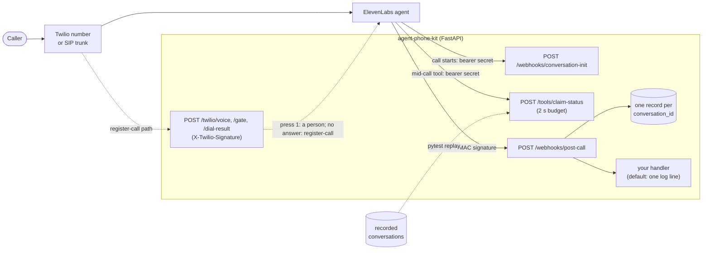

# agent-phone-kit

[](https://github.com/woodbeary/agent-phone-kit/actions/workflows/ci.yml)

A small Python kit for the server side of an ElevenLabs phone agent:

- **A server tool.** A FastAPI endpoint the agent calls mid-call (here, an insurance
  claim-status lookup), protected by a bearer secret. It answers within 2 s, with a
  fallback the agent can say when the backend is slow or down.
- **A post-call webhook receiver.** It checks the `ElevenLabs-Signature` HMAC on the
  raw body, rejects stale timestamps, drops repeat deliveries, merges each event
  into one durable record per `conversation_id` without ever nulling a field
  (SQLite, or PostgreSQL), and hands each event to your handler.
- **A substantive-call filter.** "Hello?", "test test" and "mm-hmm" calls are
  counted apart, so the substantive call rate sits next to raw volume.
- **Replay tests.** A pytest plugin that takes recorded conversations, re-sends
  every tool request the agent made, and fails with a field-by-field diff when your
  tools now answer differently.
- **A press-1 gate on your own Twilio number.** A person gets the call first; if
  nobody answers, ElevenLabs' register-call API hands it to the agent. Every request
  is checked against `X-Twilio-Signature` over each URL a proxy could have
  rewritten, and it fails closed ([docs/twilio.md](docs/twilio.md#a-person-first-the-agent-if-nobody-answers-register-call)).
- **A consent lint.** `agent-phone-kit lint agent.json` fails when a recorded
  agent's first message doesn't say the call is recorded or that an AI is
  speaking, or when the caller can talk over it. CI runs it on the example agent.
- **Telephony docs.** How to attach the agent to a [Twilio number](docs/twilio.md)
  or a [SIP trunk](docs/sip-trunking.md), with request bodies for ElevenLabs'
  phone-number API.

All data in the repo is synthetic. Phone numbers in tests use the 555-01XX range
reserved for fiction.



## Quick start

Python 3.11 or newer.

```bash
git clone https://github.com/woodbeary/agent-phone-kit && cd agent-phone-kit
python -m venv .venv && . .venv/bin/activate
pip install -e ".[dev]"
pytest

export TOOL_BEARER_SECRET="$(python -c 'import secrets; print(secrets.token_urlsafe(32))')"
export ELEVENLABS_WEBHOOK_SECRET="the secret ElevenLabs shows for your webhook"
uvicorn agent_phone_kit.app:create_app --factory --port 8000
```

```bash
curl -s localhost:8000/tools/claim-status \
  -H "Authorization: Bearer $TOOL_BEARER_SECRET" \
  -H "Content-Type: application/json" \
  -d '{"claim_number": "clm 1002"}'
# {"found":true,"claim_number":"CLM-1002","status":"in review",...}
```

To use it from another project: `pip install git+https://github.com/woodbeary/agent-phone-kit@v0.2.0`.

## The server tool

`POST /tools/claim-status` takes `{"claim_number": ..., "conversation_id": ...}`
and answers with a `message` the agent can read out. "Not found" and "that isn't a
claim number" are ordinary 200 answers so the agent can carry on the call. Claim
numbers are normalized, so `clm 1001`, `CLM_1001` and `1001` all find `CLM-1001`.

The lookup has a 2 s budget (`TOOL_BUDGET_SECONDS`). If the claims backend is
slower than that, raises, or is down, the tool still answers 200 with a fallback
the agent can say: "I can't reach the claims system right now. I can take a
callback number, or you can call back in a few minutes." Two platform limits are
why the kit enforces this itself instead of answering 503:

- ElevenLabs' `response_timeout_secs` for a tool must be between 5 and 300
  seconds, so the platform can't cut a lookup off at 2 s.
- With `tool_error_handling_mode: "auto"`, an error from a webhook tool is hidden
  from the agent, so after a 503 the agent may not know what to say.

Each lookup runs on its own daemon thread, at most 16 at once, so a hung backend
can't block the event loop, the post-call webhook or shutdown. The example tool
config sets `response_timeout_secs: 5` as the backstop and `pre_tool_speech:
"auto"`, which lets the agent say something before a tool it has seen be slow.

The tool config to paste into ElevenLabs is
[`examples/elevenlabs/claim_status_tool.json`](examples/elevenlabs/claim_status_tool.json).
It fills `conversation_id` from the `system__conversation_id` dynamic variable and
sends the `Authorization` header from a workspace secret. Store the secret's value
as `Bearer <TOOL_BEARER_SECRET>`; if your first call gets a 401, check that prefix.

To use your own claims system, implement `ClaimStore.get()` and pass it in:
`create_app(claims=MyStore())`.

## The post-call webhook

ElevenLabs signs each delivery. Per its
[post-call webhook docs](https://elevenlabs.io/docs/eleven-agents/workflows/post-call-webhooks),
you verify the `ElevenLabs-Signature` header with the SDK's `construct_event`.
That function ([source](https://github.com/elevenlabs/elevenlabs-python/blob/main/src/elevenlabs/webhooks_custom.py))
defines the scheme this kit implements:

| | |
| --- | --- |
| Header | `ElevenLabs-Signature: t=<unix seconds>,v0=<hex digest>` |
| Digest | HMAC-SHA256 over `"<t>.<raw request body>"`, keyed with the webhook secret |
| Stale | rejected when `t` is more than 30 minutes old |

`agent_phone_kit.signature.verify_signature` follows that, and also compares
digests in constant time, rejects timestamps more than 5 minutes in the future,
and lets you change the 30-minute window (`WEBHOOK_TOLERANCE_SECONDS`).

The receiver at `POST /webhooks/post-call`:

1. answers 401 to a missing, wrong or stale signature. ElevenLabs does not retry a 400 or 401;
2. answers 400 to a signed body that isn't a JSON event with `data.conversation_id`;
3. answers `{"status": "duplicate"}` to a repeat of an event it has already handled,
   keyed on type, conversation ID and event timestamp (a retry carries the same
   payload). The keys are kept in the call store, so a restart doesn't forget them.
   A repeat that arrives while the first delivery is still being handled gets a
   503 with `Retry-After`, so it is retried rather than lost;
4. merges the event into the call's record (see [The call record](#the-call-record));
5. calls your handler with the event and a `CallSummary`: tools called, tool
   errors, transfers, duration, any `tool_latency_secs` ElevenLabs reports, and
   `substantive`: whether the caller said anything beyond "hello?", "test" or
   "mm-hmm" (see [Counting calls](#counting-calls)).
   The default handler logs that summary as one JSON line, with no transcript text.
   Pass your own with `create_app(on_post_call=...)`;
6. answers 500 if the store or your handler raises, and forgets the delivery so a
   retry is processed. Merging the same event again changes nothing.

Two things to know when you deploy:

- [Retries](https://elevenlabs.io/docs/eleven-api/resources/webhooks#retries) are
  off by default; turn them on. A delivery that fails with a 5xx, 408, 429 or a
  connection error is retried up to 5 times: at once, then after 30 s, 2 min,
  8 min and 30 min, each with up to 10% jitter. The docs don't say whether a
  retry is signed again, so if late retries show up in the log as
  `rejected post-call webhook: timestamp is ... old`, raise
  `WEBHOOK_TOLERANCE_SECONDS`.
- The default call store is one SQLite file (`CALL_STORE_PATH`, default
  `calls.sqlite3`). With more than one process or host, use PostgreSQL:
  [docs/postgres.md](docs/postgres.md) has the recipe, the same SQL with
  PostgreSQL placeholders.

## The call record

ElevenLabs sends several events for one call (`post_call_transcription`,
`post_call_audio`, `call_initiation_failure`), may retry each, and a later event
can carry less than an earlier one. If every event simply overwrote the row, a
thin late event would write NULL over a good value, which is how a real CRM's live
updates once broke. `agent_phone_kit.calls.CallStore` keeps one record per
`conversation_id` and merges every event into it with one
`INSERT ... ON CONFLICT (conversation_id) DO UPDATE` statement:

- **Nothing is nulled.** Each column is `COALESCE(new, old)`; an event that
  doesn't carry a field leaves it alone.
- **Order is guarded by `event_timestamp`.** An event older than the newest one
  merged only fills fields that are still empty. It never overwrites a newer value.
- **Events fold together.** The transcription's summary, tools and duration and
  the audio event's arrival end up on the same record, in either order.
- **Call legs fold together.** One call can be several Twilio calls: the inbound
  call your gate answered, a `<Dial>` to a person who didn't pick up, the call the
  agent was on, a transfer. The record keeps every call SID it has seen, labeled
  `parent`, `human`, `agent` or `transfer`, and no later event drops one. The
  agent's leg comes from `metadata.phone_call.call_sid`; the gate below passes the
  parent and human legs as the `parent_call_sid` and `human_call_sid` dynamic
  variables; your own transfer callbacks add theirs with `store.add_leg(...)`. For a
  native Twilio `transfer_to_number`, ElevenLabs reports the conference it put the
  caller in, not the new leg's SID, so the record keeps `transfer_conference`; the
  transferred leg is a participant of that conference in Twilio.

The record holds the agent, status, start time, duration, termination reason,
`call_successful`, ElevenLabs' transcript summary, failure reason, tools called,
tool errors, `tool_latency_secs`, whether it was transferred, whether it was
substantive, whether audio arrived, the transfer conference, the call legs, the
first and last event timestamps, and the event types merged. It holds no
transcript text and no audio. Read it with `store.get(conversation_id)` or
`agent-phone-kit show CONVERSATION_ID`, or pass your own store with
`create_app(store=...)`.

`tests/test_calls.py` sends the same webhook twice, then a thinner copy a minute
later, then the audio event, and checks there is one record with no field nulled.

## Counting calls

Hang-ups, "hello?" and test calls inflate call volume and wreck success rates, so
decide what counts before you show anyone a number.
`agent_phone_kit.substantive.is_substantive` marks a caller turn as filler when
every word in it is a greeting or backchannel (`FILLER_WORDS`), or when it is one
word of four characters or fewer, said once or repeated ("what", "um um"). A call
is substantive when any caller turn isn't filler.

It is a port of a TypeScript rule from a production phone line, with two bugs
fixed. That rule stripped hyphens before looking the message up in a list that
still had them, so "mm-hmm" became "mmhmm" and passed on length (the list now
also has the halves, for "mm hmm" and "uh huh" spelled with a space); and it only
matched the whole message, so "hello hello", "test test" and "um um" passed.
`tests/test_substantive.py` is a table of messages with what the old rule said
next to what the port says. Tune `FILLER_WORDS` for your callers and languages.

`store.volume()` reports raw volume next to the substantive call rate, from the
call records:

```python
>>> store.volume(since=1767225600).as_dict()
{'calls': 6, 'substantive_calls': 2, 'substantive_call_rate': 0.3333, 'unknown_calls': 1,
 'tool_results': 3, 'tool_latency_p50_secs': 0.4, 'tool_latency_p95_secs': 1.9}
```

`calls` counts every conversation with a record; `substantive_call_rate` is
substantive calls over that. `unknown_calls` had no transcript event (only audio,
or a call that failed to start). The latency percentiles are nearest-rank over
every `tool_latency_secs` ElevenLabs reported in those calls, with the count next
to them (`tool_results`). The numbers above are from the synthetic test data.

## Consent in the call

The person on the phone never accepted your terms, so the first thing the agent
says has to tell them what is going on. `agent-phone-kit lint` reads an agent
config (the body you send to create or update an agent, or what
`GET /v1/convai/agents/{agent_id}` returns) and exits 1 when:

- `platform_settings.privacy.record_voice` is true (or not set, which the lint
  treats as recorded) and `conversation_config.agent.first_message` is empty or
  says nothing about recording or AI; or
- `conversation_config.agent.disable_first_message_interruptions` isn't true, so
  the caller can talk over the disclosure and never hear it.

```console
$ agent-phone-kit lint examples/elevenlabs/agent.json
examples/elevenlabs/agent.json: ok
$ agent-phone-kit lint my-agent.json
my-agent.json: conversation_config.agent.first_message: the call is recorded but the first message doesn't say so or that an AI is speaking
my-agent.json: conversation_config.agent.disable_first_message_interruptions: must be true, or the caller can talk over the disclosure and never hear it
```

It looks for words ("recorded", "transcribed", "AI", "virtual assistant"), not
meaning, and only in the default English first message, so read yours too. Run it
in CI on the config you deploy, as this repo does on the example.

## The initiation webhook

For inbound Twilio and SIP calls, ElevenLabs can ask your server for dynamic
variables before the agent speaks. `POST /webhooks/conversation-init` answers with
`caller_on_file`. It never fails because a lookup failed, since a failed
webhook can stop the call from starting. Caller ID can be spoofed, so it is used
only to personalize, not to authenticate.

## Replay tests

A recorded conversation is ElevenLabs' own JSON: a `post_call_transcription`
webhook body, its `data` object, or `GET /v1/convai/conversations/{id}`. Each
webhook tool call in its transcript holds the request the agent sent
(`tool_details`: method, URL, query, body), and a matching `tool_results` entry
holds the `result_value` it got back. Replay re-sends each request to your app
and compares the JSON field by field. It does not re-run the LLM or the voice;
for agent behavior, use [ElevenLabs' agent tests](https://elevenlabs.io/docs/eleven-agents/customization/agent-testing).

Point the plugin at a folder and write one test:

```toml
# pyproject.toml
[tool.pytest.ini_options]
phone_kit_conversations = ["tests/conversations"]
```

```python
def test_recorded_calls_still_replay(recorded_conversation, replay_conversation):
    replay_conversation(recorded_conversation)
```

Each JSON file in the folder becomes its own test case. If someone changes what
the tool says about claim CLM-1001, the replay fails like this:

```
claim_approved.json: 1 of 1 tool call(s) differ
  claim_status [req_0001_a] POST /tools/claim-status
    message: expected 'Claim CLM-1001 is approved. Payment goes out within five business days.', got 'Claim CLM-1001 is denied. A letter explains why.'
    next_step: expected 'Payment goes out within five business days.', got 'A letter explains why.'
    status: expected 'approved', got 'denied'
```

The plugin's fixtures: `phone_kit_settings` (random throwaway secrets),
`phone_kit_app` (override it in your `conftest.py` to test your own app),
`phone_kit_client`, `replay_conversation` (takes `ignore_fields=` for values that
change between runs) and `signed_post_call` (posts a payload signed the way
ElevenLabs signs it).

Outside pytest, replay against a running server:

```python
import httpx
from agent_phone_kit.replay import replay

with httpx.Client(base_url="https://staging.example.com") as client:
    report = replay(client, "call.json", headers={"Authorization": f"Bearer {secret}"})
print(report.explain())
```

Before you commit a real call as a fixture, replace names, phone numbers, claim
numbers and anything else personal with fake values. Recorded headers are never
replayed; replay sends the auth you give it.

## What is tested, and what isn't

`pytest` runs on Python 3.11, 3.12 and 3.13 in CI, after `ruff check` and
`ruff format --check`. A second CI job installs the latest `elevenlabs` SDK and
runs `tests/test_sdk_conformance.py`; it also runs weekly. A third runs the call
store's tests on PostgreSQL.

- **Signature:** a known-answer vector computed separately with `openssl dgst
  -sha256 -hmac`; tampered body, wrong secret, changed timestamp, stale and
  far-future timestamps, the exact 30-minute edge, malformed headers.
- **SDK conformance:** for valid, stale, tampered and malformed deliveries, the
  kit and the SDK's own `construct_event` accept and reject the same ones. The one
  intended difference, far-future timestamps, has its own test. The example tool
  and phone-number configs parse as the SDK's request models with no unknown fields.
- **Endpoints:** bearer auth (missing, wrong scheme, wrong token), normalization,
  not-found answers, the fallback for a slow (hanging), failing or overloaded
  backend, the initiation webhook with a broken lookup, and the post-call
  receiver's 401, 400, duplicate, in-progress and 500-then-retry paths.
- **Call record:** twice-then-thinner, older events filling only gaps, events
  without a timestamp, transcription and audio in either order, duplicates after a
  restart, and a claim abandoned by a crash being reclaimed after 5 minutes. A
  third CI job runs the same store tests on PostgreSQL 16, including two
  connections folding events into one record and racing for one claim.
- **Replay and plugin:** the synthetic conversations in `tests/conversations`
  (including a native Twilio call with a `transfer_to_number` and an in-browser
  widget conversation, which has no phone metadata; the receiver and replay treat
  it the same)
  replay cleanly; a changed tool answer fails with a diff; the plugin is run
  inside throwaway projects with `pytester`, including an app override.
- **Twilio gate:** a signature vector computed with `openssl`; a `+1` number in
  the query string behind a rewritten host (forwarded headers, a public base URL,
  a `+` decoded to a space or unescaped from `%2B`, a dropped trailing slash); 403
  for unsigned, wrongly signed and tampered requests on every route; the press-1,
  retry, goodbye, answered and no-answer paths; register-call against a fake
  ElevenLabs API on loopback, including its failures; E.164 normalization; and the
  gate's call legs landing on one record. The SDK job checks the register-call
  body against the SDK's own parameters.
- **Command:** the demo's received, duplicate, thinner-late-copy, forged and stale
  steps against the kit served on `127.0.0.1`, and `show` and `stats` on the
  result.
- **Consent lint:** recorded with and without a disclosure, no first message,
  `record_voice` unset or false, interruptions allowed, a table of disclosure
  wording, and the command's exit codes, run in-process and as `python -m`.
- **Examples:** the tool config's URL, method and body fields match the app's
  route and request model, and the phone-number bodies hold only placeholders.

Not tested here: a live call through ElevenLabs, Twilio or a SIP trunk, or a
real register-call; whether `result_value` in a real exported call is the raw
response body, as replay assumes (the fixtures follow the transcript types in
ElevenLabs' SDK); performance. There are no latency numbers in this repo.
To measure tool latency on your own deployment, place real calls and run
`agent-phone-kit stats` against the call store: it reports the call count, the
substantive call rate, and nearest-rank p50 and p95 of every `tool_latency_secs`
ElevenLabs reported, with how many tool results that is. Report those numbers
with the call count and that method.

## The command

`agent-phone-kit` has four subcommands:

- `lint agent.json`: the consent lint (exit 1 on a problem, 2 on unreadable input).
- `post-call body.json [--later S] [--drop data.analysis] [--stale S] [--forge]`:
  signs a saved post-call body the way ElevenLabs does and POSTs it to the kit
  (default `http://127.0.0.1:8000/webhooks/post-call`, or `--url`). The secret
  comes from `ELEVENLABS_WEBHOOK_SECRET`, never the command line. One command each
  shows a duplicate, a thinner late copy, a stale signature and a forged body.
- `show CONVERSATION_ID [--db calls.sqlite3]`: one call's merged record from the
  call store, as JSON.
- `stats [--db calls.sqlite3] [--since UNIX_SECONDS]`: raw volume, substantive
  call rate and tool latency from the call store.

[docs/demo.md](docs/demo.md) is a two-minute demo built on them and the
claim-status tool.

## Layout

```
src/agent_phone_kit/
  app.py            create_app(): wires the routers below
  claims.py         the example server tool
  initiation.py     conversation initiation webhook
  post_call.py      post-call receiver and CallSummary
  calls.py          CallStore: one durable record per conversation_id
  substantive.py    is_substantive(): the substantive-call filter
  twilio_gate.py    press-1 gate, register-call fallback, Twilio signature checks
  consent.py        the consent lint
  cli.py            the agent-phone-kit command
  signature.py      ElevenLabs-Signature verify and sign
  auth.py           bearer-secret dependency
  settings.py       Settings.from_env(): secrets, tolerance, tool budget, store path
  replay.py         recorded-conversation replay
  pytest_plugin.py  fixtures and the phone_kit_conversations option
examples/elevenlabs/  tool, agent and phone-number configs
docs/                 Twilio and SIP trunking guides
tests/                tests and synthetic conversations
```

## License

MIT. Copyright 2026 Jacob Lopez.
